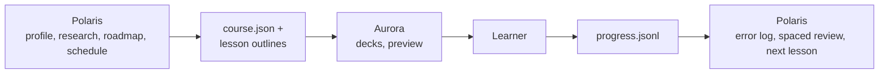

**English** · [Tiếng Việt](README.vi.md)

<p align="center"></p>

# Aurora Slides MCP

*The aurora as light on a stage for lessons: illuminating ideas in vibrant waves across the night.*

An MCP server that lets AI coding agents (Google Antigravity, Claude Code, Cursor…) build **self-study slides as beautiful as an
Apple Keynote**: big type, frosted glass, slowly drifting aurora backgrounds, spring animations, Magic Move, an **exploded view like
the old Mac product pages** (the whole object → zoom in → its parts separate as you scroll), and interactive learning blocks:
quizzes, flip cards, cloze, **notebook pages**, **timed exercises** and **memory anchors** (memory palace, picture anchors,
analogies, mnemonics). Every lesson is **one self-contained HTML file**: open it in a browser and start learning.

It is built around one way of studying, **theory → memory anchors → copy into a notebook → practice → review**, and around
**courses of small lessons**: a big subject (say, quantum computing) is split into short lessons, **each with its own look**,
plus a course home page that tracks progress.

Current version: **0.8.0**. Author: **DuongNAD**.

## Aurora + Polaris

Aurora Slides pairs with sister project [Polaris](https://github.com/DuongNAD/polaris-mcp), the learner's AI course architect.
Polaris creates the learner profile, conducts deep research with sources, designs roadmaps, schedules lessons, and exports `course.json` plus lesson outlines to `<subject>/polaris/lessons/<lesson>.outline.md`.
Aurora renders the interactive slides and records the learner's self-study progress into `progress.jsonl`.
Polaris reads `progress.jsonl` via `polaris_progress_sync` to populate the learner's error log ("Sổ lỗi") and plan spaced reviews.



- **Live progress recording**: while studying under `aurora_preview`, quiz answers (with chosen and correct option texts and explanation), predict ratings, memory palace recall ratings, and spaced repetition card ratings automatically append to `<course folder>/progress.jsonl` (or `<deck folder>/progress.jsonl`).
- **Progress summary** (`aurora_progress`): summarizes quiz accuracy (with chosen and correct texts for wrong answers), right vs different predictions, missed memory palace stations, spaced repetition review counts (again, hard, good, easy), completion dates, and spaced review schedules (+1, +3, +7, +16, +35 days).
- **Export control**: "Xuất tiến độ" / "Export progress" button in the help panel (`?`) and on the course page downloads `aurora-progress-<slug>.jsonl`.

The canonical, versioned definition with JSON Schema and fixtures lives in Constellation's [contracts/aurora-progress-event.v1](https://github.com/DuongNAD/constellation-mcp/tree/main/contracts); this README summarizes it.

### Ecosystem

All projects by DuongNAD:

| Project | Role | Repository |
| :--- | :--- | :--- |
| **Polaris** | Course architect: sources, facts with locators, roadmap, schedule, error log | [polaris-mcp](https://github.com/DuongNAD/polaris-mcp) |
| **Aurora Slides** | Keynote-style lessons: quizzes, predict and trace slides, progress events | [aurora-slides-mcp](https://github.com/DuongNAD/aurora-slides-mcp) |
| **Vega** | FSRS memory engine and the single review queue (card inbox) | [vega-mcp](https://github.com/DuongNAD/vega-mcp) |
| **Orion** | Practice labs with real tests, tutoring ladder and PRIMM warm-up | [orion-mcp](https://github.com/DuongNAD/orion-mcp) |
| **Mira** | Code-tracing lab: real Python traces, line-by-line players with prediction gates | [mira-mcp](https://github.com/DuongNAD/mira-mcp) |
| **Rigel** | Grounded tutor: answers from the learner's lesson materials with [ref] citations | [rigel-mcp](https://github.com/DuongNAD/rigel-mcp) |
| **Sirius** | Execution loop: deadlines, triage, today router, session timer, weekly review | [sirius-mcp](https://github.com/DuongNAD/sirius-mcp) |
| **Constellation** | MCP registration, health checks and shared contracts | [constellation-mcp](https://github.com/DuongNAD/constellation-mcp) |
| **SmartDrive-OS** | SSD governance, index and learning search | [smart-drive-os](https://github.com/DuongNAD/smart-drive-os) |

### Connections

- **Polaris**: lesson outlines in, `progress.jsonl` out (`aurora-progress-event.v1`).
- **Mira**: `trace` slides embed Mira players (`mira-embed.v1`); their predictions join `progress.jsonl`.
- **Vega**: `srs` slides render Vega review sessions; `card` events go back to Vega.
- **Rigel**: cite Rigel refs (file · slide/page) in a slide's `source`.
- **Sirius**: progress events count as study evidence.

## Aurora + SmartDrive-OS

Aurora Slides automatically coordinates with sister project [SmartDrive-OS](https://github.com/DuongNAD/smart-drive-os). After Aurora writes learning materials (deck slides, course index, images, or learner progress), it asks SmartDrive-OS to update its search index for that folder (`smart-drive update <dir> --quiet` in the background) so `smart-drive search --kind slide ...` immediately finds new and edited lessons.

- **Non-blocking & coalesced**: Index notifications run detached in the background with a 60 s timeout and are coalesced per folder within 2 s.
- **Opt-out**: Set `AURORA_SMARTDRIVE=off` to disable SmartDrive-OS indexing notifications.
- **Custom command**: Set `AURORA_SMARTDRIVE_CMD` (e.g. `python -m smart_drive` or a path to the executable) if `smart-drive` is not on PATH.

## Aurora + Mira

Sister project Mira records **real Python execution traces** and builds a self-contained player (one offline `index.html`) that steps through the code line by line beside a visualisation, with **prediction gates** where the learner types what will happen before the next step.
Aurora embeds that player in a lesson with the `trace` slide and relays its predictions into the same progress pipeline as quizzes and `predict` slides, so Polaris (error log) and Vega (cards) receive them with no other change.

```json
{
  "type": "trace",
  "id": "tim-kiem-nhi-phan",
  "eyebrow": "Chạy từng dòng",
  "title": "Tìm kiếm nhị phân qua từng bước",
  "player": "mira/tim-kiem-nhi-phan/index.html",
  "caption": "Ở mỗi điểm dừng, hãy đoán giá trị của mid trước khi bấm tiếp. Nhấn Esc để quay lại điều hướng slide."
}
```

- **Build**: `player` is a path to the player's `index.html`, relative to the deck folder or absolute. The build copies it to `assets/mira/<folder>-<6 hex of sha1(path)>.html` inside the deck folder (rewritten only when its content changed) and renders a lazy iframe (`assets/mira/….html?embed=1`) in a macOS-style window. A missing file, or a page without `<meta name="mira-player">`, only gives a build warning and a calm fallback card.
- **Embed protocol `mira-embed.v1`**: the player posts `ready`, `event` and `blur` messages (`{source: "mira", v: 1, …}`) to the deck. Aurora accepts them only from its own trace iframes, answers `ready` with a `hello` (theme and accent), relays only valid `predict` events (strings truncated to 200 / 2000 / 300 characters, `slideId` `mira-stop-<k>`) as `<slide id>:mira-stop-<k>`, ignores the player's own `complete` (Aurora sends its own) and returns the keyboard to the deck on `blur`, which the player sends when Esc is pressed inside it.
- **Progress**: events go to the localStorage buffer, to `progress.jsonl` under `aurora_preview` and to the export button like every other event; `aurora_progress` lists them under `Dò code (Mira)`.
- **Print and PDF**: the player is replaced by a static block with the title, the caption and `Interactive version: assets/mira/….html`.

## Highlights

- **The agent makes the pictures, no API keys spent**: illustrations are made by the agent itself (Antigravity has its own image
  tool) and imported into the lesson. A slide only needs `"image": {"generate": "<description>"}`; at build time Aurora **calls no
  API** and returns a list of "pictures to make" for the agent to draw and import. OpenAI/Gemini keys on the machine are ignored
  unless you opt in (see below).
- **Your language**: the instructions sent to the agent (the MCP server instructions, the `lesson`/`course` prompts, `aurora_guide`)
  are written in English so agents follow them precisely, but they require the lesson content and the agent's replies to use the
  language you wrote the request in (ask in Vietnamese and you get Vietnamese slides with `lang: "vi"`). Image prompts, ids and
  Mermaid keywords stay in English.
- **40 slide types**: title, section, agenda, statement, bullets, split, image (with camera zoom), explode, bento, stats, quote,
  code, timeline, steps, cycle, compare, table, chart, formula, definition, hotspots, notebook, exercise, predict, quiz, flashcards,
  srs, cloze, summary, video, html, palace, anchors, analogy, mnemonic, diagram, order, match, sort, trace.
- **Code traces from Mira** (`trace`): a player built by sister project Mira steps through real Python line by line beside a visualisation and stops at prediction gates; Aurora embeds it in a macOS-style window and relays the predictions into the progress log (see Aurora + Mira).
- **Lesson scenes** (`scene`): the background and its motion match the subject. Twelve animated scenes (leaves, cells, dna, quantum,
  waves, molecules, circuit, network, code, orbits, geometry, ink) are drawn in the theme's colours, work offline and stay calm
  behind the title; `scene: "auto"` (the default) picks one from the lesson title, a course can give each lesson its own, and a
  `section` can switch it for its chapter. Hero icons move with their meaning (a leaf sways, the sun's rays turn, an electron orbits
  its atom) and photo backdrops drift slowly (Ken Burns). `aurora scenes` builds a gallery to look at them.
- **Hands-on practice** (`order`, `match`, `sort`, typed `cloze`): drag steps into sequence, connect terms to their meanings with
  curves, sort chips into groups, or type the missing words (accent-insensitive, with a note when only the accents differ). Everything
  also works with clicks, the keyboard and touch; "Try again" and "Show answer" follow each check, and the first attempt is reported
  through the existing `quiz` progress event, so Polaris logs mistakes with no contract change. Quizzes gained "Try again" too.
- **Liquid Glass look**: glass cards with a lit top edge and a soft light that follows the pointer, a backdrop that drifts from slide
  to slide and shifts hue per chapter, chapter openers with a gradient number and a chapter rail, and a progress bar split into
  chapters that shows the slide title on hover and jumps on click.
- **Spaced repetition review sessions** (`srs`): sister project [Vega](https://github.com/DuongNAD/vega-mcp) (FSRS engine) generates review decks composed of `srs` slides (front → hint → flip to back → 1–4 rating "Again / Hard / Good / Easy"), emitting `card` progress events to reschedule cards.
- **Predict-then-run practice** (`predict`): the learner writes their prediction into a persisted input box, runs the real code in an
  animated macOS terminal, compares the real output, self-rates with keys 1/2 ("As predicted" / "Different"), and logs gaps into their error log.
- **Verbatim code quoting** (`code`, `split`, `exercise`, `predict`): quote real source files with `file` + `lines` (and `dedent`),
  showing real gutter line numbers and syntax highlighting without retyping from memory.
- **Per-slide citations** (`source`): every slide can carry a clean, muted footnote at the bottom-left with tooltip and markdown links.
- **Memory anchors**: `palace` is a memory palace. The camera walks a route through a place you know (your home, the way to
  school); each stop holds one idea with a scene to picture, linked to its card by a leader line; scroll to walk. Use a drawn map
  or a photo of the place. At the end comes a recall walk: the ideas are hidden, you recall each stop and rate it Got it / Missed.
  Also: `anchors` (one picture per concept), `analogy` (anchored to something you already know, with where it breaks),
  `mnemonic` (acrostics and rhymes), and `@ ` lines on notebook pages for writing down the hook.
- **Mermaid diagrams** (`diagram`): the agent writes [Mermaid](https://mermaid.js.org) code for flowcharts, mind maps, sequence,
  state, class and ER diagrams, timelines, Gantt, Sankey, bar and pie charts… Aurora renders them to SVG at build time in
  Chrome/Edge, colored by the lesson's theme, so lessons stay light and work offline. When presenting, boxes fade in and arrows
  draw themselves between them; `steps` reveals one box per → press; `look: "handDrawn"` gives a sketchy style. A syntax error
  shows on the slide with the failing line so the agent can fix it.
- **9 themes**: aurora, midnight, daylight, titanium, ocean, sunset, forest, paper, liquid (Liquid Glass).
- **Courses**: `course.json` + a course home page (lesson cards in each lesson's theme colors, optional `when` scheduling labels, a progress ring, a "Continue"
  button); every lesson links back to the course and has a "Next lesson" button. The course page drives **spaced review**:
  finished lessons show "Due for review" after 1, 3, 7, 16 and 35 days.
- **Grounded accuracy & pedagogy lint**: built-in lint checks for memory palaces, recall walks, navigation ratios, practice volume, code prediction, and citations. Guide topic `accuracy` teaches agents to ground lessons in user materials, quote code verbatim, and use plausible quiz distractors.
- Math (KaTeX) and chemistry `\ce{...}`; Xcode-style code highlighting; live-reload preview; PDF export; **Be Vietnam Pro**
  embedded so Vietnamese diacritics never break.

## Pictures: the agent makes them first

The order Aurora recommends to agents (it is written in the guide and in the tool descriptions, so agents follow it on their own):

1. **The agent makes the picture** with its own tool (Antigravity generates images right in the conversation). Two ways to wire
   it in:
   - Make the picture first, then `aurora_add_image {"dir": …, "path": "<image file>"}` copies it into the lesson's `images/` folder.
   - Or write `"image": {"generate": "<prompt>"}` in the slide. The build result then has a **"Pictures for you to make"** list:
     each picture has an id, slide number, shape (landscape 16:9, portrait 3:4, square 1:1) and prompt. The agent makes each one
     and calls `aurora_add_image {"dir": …, "path": "<image file>", "for": "<id>"}`: the picture is saved as
     `images/gen-<id>.png` and the lesson rebuilds itself. Until then the slide shows a frosted-glass placeholder with the prompt.
     The prompts stay in `deck.json`, so a remake of the lesson keeps the same style.
2. **Real photos from the web**: `{"query": "chloroplast microscope"}` or `aurora_search_images` (Openverse and Wikimedia for
   free; Unsplash/Pexels with a key).
3. **The agent draws SVG** (`{"svg": "<svg …>"}`) for simple figures: axes, circuits, cells, Bloch spheres.
4. **Fallback** for agents that cannot make images: `aurora_generate_image` uses Pollinations (free, no key, lower quality).

To let Aurora call OpenAI/Gemini at build time (this costs money), set `AURORA_IMAGE_PROVIDER`:

| Value | Meaning |
|---|---|
| `agent` (default) | No image API is called at build time; prompts become a list of pictures for the agent. Keys on the machine are ignored |
| `pollinations` | Generated at build time with Pollinations (free, small watermark) |
| `openai` / `gemini` | Generated at build time with OpenAI gpt-image / Gemini (needs `OPENAI_API_KEY` / `GEMINI_API_KEY`, costs money) |
| `auto` | The old behavior: OpenAI, then Gemini (when keys are set), then Pollinations |

A picture already in the lesson's `images/gen-<id>.*` is always reused in every mode, so you never pay twice.

## Install

Requirements: Node.js 22.4+ and Google Chrome or Microsoft Edge (for diagrams, screenshots, audits and PDF export).

`dist/aurora.mjs` is prebuilt in the repo: clone it and it runs, nothing else to install.

```bash
git clone https://github.com/DuongNAD/aurora-slides-mcp.git
```

After changing the source (`src/`, `runtime/`, `guide/`), rebuild:

```bash
node scripts/build.mjs --install --check
```

This installs the toolchain (TypeScript, esbuild, MCP SDK, KaTeX, Shiki…) into `%LOCALAPPDATA%\aurora-slides\toolchain`
(Linux/macOS: `~/.cache/aurora-slides/toolchain`) and builds `dist/aurora.mjs`. The first run also downloads the Mermaid package
from npm but keeps only one file, `assets/mermaid.min.js` (about 5 MB, used at build time only, never embedded in lessons).
After that, `node scripts/build.mjs --check` is enough.

> **Do not run `npm install` in the project folder.** The project has no `node_modules` on purpose: every dependency lives in the
> external toolchain and the repo keeps a single bundle. That way the project can sit on an exFAT drive or a USB stick (large
> clusters) without thousands of tiny files.

## Connect your agent

With Constellation installed, `constellation register --dry-run` then `constellation register` keeps every agent config in sync.

Register Aurora as `aurora-slides`, then reload the MCP servers (or restart Antigravity / Claude Code) so the agent sees the tools.
Replace `C:/path/to/aurora-slides-mcp` with the folder you cloned.

**Google Antigravity**: add it to `mcpServers` in `%USERPROFILE%\.gemini\antigravity\mcp_config.json`
(Cursor uses the same format in `.cursor/mcp.json`):

```json
{
  "mcpServers": {
    "aurora-slides": {
      "command": "node",
      "args": ["C:/path/to/aurora-slides-mcp/dist/aurora.mjs"]
    }
  }
}
```

**Claude Code**:

```bash
claude mcp add aurora-slides --scope user -- node "C:/path/to/aurora-slides-mcp/dist/aurora.mjs"
```

Optional environment variables (put them in the `"env"` block of the MCP config):

| Variable | Effect |
|---|---|
| `AURORA_IMAGE_PROVIDER` | How `generate` is handled: `agent` (default), `pollinations`, `openai`, `gemini`, `auto` (see Pictures) |
| `OPENAI_API_KEY` / `GEMINI_API_KEY` | Used only when `AURORA_IMAGE_PROVIDER` is `openai`, `gemini` or `auto` |
| `AURORA_OPENAI_IMAGE_MODEL`, `AURORA_GEMINI_IMAGE_MODEL` | Change the image model |
| `UNSPLASH_ACCESS_KEY`, `PEXELS_API_KEY` | Nicer Unsplash/Pexels photos instead of Openverse/Wikimedia |
| `AURORA_DECKS_DIR` | Default folder for lessons (default: `./slides` of the project the agent has open) |
| `AURORA_BROWSER` | Path to Chrome/Edge if it is not found automatically |
| `AURORA_PORT` | Preview server port (default 4747) |
| `AURORA_HOME` | Cache folder for icons, images and diagrams (default `%LOCALAPPDATA%\aurora-slides`) |
| `AURORA_SMARTDRIVE` | Set to `off` to disable automatic SmartDrive-OS index notifications |
| `AURORA_SMARTDRIVE_CMD` | Custom command for SmartDrive-OS (e.g. `python -m smart_drive`) |

## How to use it

Just ask your agent. For example, today's lesson, given to Antigravity:

> Use aurora-slides to make today's lesson on **Ohm's law** for me: theory → memory anchors → a notebook page → exercises from
> easy to hard → review. **Make the illustrations with your own image tool**, one style for the whole lesson, no text inside the
> pictures, and import them with `aurora_add_image`. Then take screenshots to check it, fix the audit errors and open the preview.

Or a whole course:

> Use aurora-slides to make a **Quantum computing** course of 5 small lessons: quantum theory, quantum gates, entanglement,
> circuits and algorithms, hardware. Give each lesson its own theme, a notebook page after the theory and exercises from easy to
> hard. Make the hardware lesson an exploded view of a quantum computer. Each lesson gets a memory palace in my home for its key
> ideas and a recall walk at the end. Make the pictures yourself and import them. Then check the screenshots and open the preview.

Write the request in any language: the slides and the agent's replies come back in that language.

Claude Code also has ready-made prompts: `/mcp__aurora-slides__course` and `/mcp__aurora-slides__lesson`.

Lessons are saved in `./slides/<lesson-name>/` of the project the agent has open (`deck.json`, `index.html` and `images/`).
Open `index.html` in a browser to study.

Tools the agent uses:

| Tool | Job |
|---|---|
| `aurora_guide` | How to write slides: every slide type with a JSON example, how to split a course, how to get pictures |
| `aurora_create_course` | Create or edit a course: lesson list, theme per lesson, course home page |
| `aurora_create_deck` | Create or overwrite a lesson (deck.json + index.html), precise errors for bad JSON, list of pictures to make |
| `aurora_edit_deck` | Edit single slides: replace, insert, delete, move, update, deck |
| `aurora_get_deck`, `aurora_build` | Read a deck back; rebuild a deck or a whole course |
| `aurora_add_image` | Import a picture the agent made or found (file, URL, base64); `for` fills a waiting slide picture and rebuilds |
| `aurora_search_icons`, `aurora_search_images` | Search icons (Iconify, 200,000+) and web photos |
| `aurora_generate_image` | Fallback for agents that cannot make pictures (free Pollinations) |
| `aurora_screenshot`, `aurora_audit` | The agent looks at its slides (down to single animation steps) and checks the layout |
| `aurora_preview` | Preview server on 127.0.0.1 with live reload (a deck or a whole course) |
| `aurora_progress` | Summarize progress events (quiz accuracy, predictions, missed palace stops, spaced reviews) |
| `aurora_export_pdf` | Export a 16:9 PDF |

## While studying

| Key | Action |
|---|---|
| → / Space / scroll down | Next (one point, one notebook line, one solution step, one exploded-view stage, flip SRS card) |
| ← / scroll up | Back |
| N | The slide's detailed notes |
| O / Esc | Overview of the whole lesson |
| F | Fullscreen |
| T | Start/pause the exercise timer |
| 1–6 | Pick a quiz answer |
| 1–4 | Rate spaced repetition card (Again / Hard / Good / Easy) on `srs` slides |
| 1 / 2 | Got it / Missed during memory palace review; As predicted / Different on predict slides |
| H | Reveal/toggle hint on `srs` slides |
| Esc (inside a Mira player) | Hand the keyboard back to the deck, so → / ← move through slides again |

On exploded-view and memory palace slides, the mouse wheel or trackpad scrubs the animation continuously, like an Apple page.
Lessons remember where you stopped; the course page shows each lesson's progress and which lessons are due for review.

## Troubleshooting

### Antigravity: "tool … is not enabled for server aurora-slides"
In Google Antigravity, tools are discovered and bound when a conversation begins. When starting Antigravity, MCP servers can take 1–2 minutes to finish initializing in the background. If you send a message before the server is ready, the conversation will not have tool access.
**Fix**: Wait a moment until the MCP server is initialized, then open a **new conversation**.

## CLI

```bash
node dist/aurora.mjs build examples/quang-hop             # build a lesson (also prints the pictures to make, if any)
node dist/aurora.mjs build examples/may-tinh-luong-tu     # build a whole course
node dist/aurora.mjs serve examples/may-tinh-luong-tu --open
node dist/aurora.mjs shot examples/quang-hop --sheet      # contact sheet
node dist/aurora.mjs shot examples/quang-hop --slides 8 --step 2
node dist/aurora.mjs audit examples/quang-hop
node dist/aurora.mjs pdf examples/quang-hop
node dist/aurora.mjs images "chloroplast microscope"      # search photos
node dist/aurora.mjs icons leaf atom --style duotone      # search icons
node dist/aurora.mjs generate "glowing qubit chip, dark navy, soft light, no text"   # free Pollinations
node dist/aurora.mjs showcase --theme forest              # sample deck that uses every layout
node dist/aurora.mjs selftest                             # drive the runtime in headless Chrome
node scripts/e2e.mjs                                      # end-to-end MCP test (every tool, including the agent picture flow)
```

## Examples

Both examples are in Vietnamese.

- `examples/quang-hop`: a lesson on photosynthesis (theory → memory anchors → notebook → practice → review): the memory palace
  "The light reactions: a walk around the house", an analogy between chloroplasts and a solar power plant, a mnemonic for the
  Calvin cycle, and a Mermaid mind map of the whole topic.
- `examples/may-tinh-luong-tu`: a 5-lesson course on quantum computing (3 lessons written, 2 marked "Coming soon"), each with its
  own theme; lesson 1 has a memory palace drawn on an apartment floor plan (7 ideas about qubits, 7 corners of the home), lesson 2
  opens with a recall walk of lesson 1 and has a step-by-step Mermaid flowchart of the Bell-state circuit, and lesson 5 has an
  exploded view of a dilution refrigerator.

## Layout

```
src/        TypeScript: schema, render, course, imagegen, MCP tools, CLI
runtime/    aurora.css + aurora.js that run in the browser
guide/      GUIDE.md for agents
examples/   sample lessons and a sample course
assets/     minified runtime, base64-embedded fonts and KaTeX, mermaid.min.js (made by the build)
dist/       aurora.mjs: one file with the whole server (prebuilt, committed)
scripts/    build.mjs (toolchain outside the project), e2e.mjs (MCP test)
PLAN.md     status, next ideas, constraints
```

## Version history

- **0.8.0** (2026-10-12):
  - Liquid Glass look: lit glass edges and a pointer light on cards, quiz options, flashcards and the HUD; backdrop drift per slide and a hue shift per chapter; section slides with a gradient number and a chapter rail; a chapter-aware progress bar that scrubs (hover shows the slide title, click jumps).
  - Practice slides `order`, `match`, `sort` and `cloze` with `input: true` (alternatives `[[shown|alt]]`): pointer drag with FLIP motion plus click, keyboard and touch paths; deterministic build-time shuffles; first attempts reported as `quiz` events; "Try again" / "Show answer"; quizzes gained "Try again".
  - Lesson scenes: 12 animated scenes matching the subject (`scene` on a deck, a course lesson or a section; `auto` picks from the title with diacritic-aware Vietnamese and English keywords), hero icon motion (`motion`), Ken Burns on photo backdrops, scene previews on course cards, the `aurora scenes` gallery command.
  - New `trace` slide embeds a player built by sister project Mira (`mira_build`): the build copies the player to `assets/mira/` and renders a lazy iframe in a macOS-style window; a missing player or a page without the `mira-player` meta tag only warns and shows a fallback card.
  - Embed protocol `mira-embed.v1`: the runtime accepts `ready`, `event` and `blur` messages only from its own trace iframes, answers `ready` with a `hello` (theme, accent), relays valid `predict` events into the progress pipeline as `<slide id>:mira-stop-<k>` (localStorage buffer, `/__aurora/progress`, export button), ignores the player's own `complete` and returns the keyboard to the deck on `blur`.
  - `aurora_progress` lists Mira predictions under `Dò code (Mira)`; a pedagogy hint when a trace has no caption and no `code` or `predict` slide before it; the audit warns about a missing player; print and PDF show a static block instead of the player.
  - Guide: the `trace` type (fields, Vietnamese example, when to use), the Esc key, and Mira, Orion and Sirius in the ecosystem lists.
  - e2e: schema, asset copy, fallbacks, message validation and a real-browser relay check.
- **0.7.1** (2026-10-11):
  - Accept `eyebrow` on `statement` slides as an alias of `kicker` (every other slide type uses `eyebrow`).
  - When both `kicker` and `eyebrow` are provided, `kicker` takes precedence and a content note is emitted.
  - Renderer treats `kicker` and `eyebrow` identically; guide and catalog document `kicker` with "(alias: eyebrow)".
  - Corrective validation errors for unknown fields and real typos continue to work as expected.
- **0.7.0** (2026-10-11):
  - Spaced repetition review sessions (`srs` slide type) produced by sister project [Vega](https://github.com/DuongNAD/vega-mcp) (FSRS memory engine).
  - Apple-style frosted glass card layout with front prompt, optional hint reveal (`H`), flip to back (→ / Space / click) with memory hook, origin link, and 1–4 rating row ("Again / Hard / Good / Easy").
  - New `card` progress event emitted on rating, capturing `card` id, `rating`, and `ms` elapsed review duration.
  - Summary slide score card displays review counts (`Đã ôn x/y thẻ · Quên a`).
  - Preview server accepts `card` events with contract validation, and `aurora_progress` summarizes rating counts per deck.
  - Pedagogy lint skips non-review notes when ≥ 80% of slides are `srs`.
- **0.6.2** (2026-10-11):
  - SmartDrive-OS integration: automatically trigger incremental index updates (`smart-drive update <dir> --quiet`) after writing decks, courses, images, and progress events so `smart-drive search --kind slide ...` finds new and edited lessons at once. Coalesced per folder within 2 seconds, non-blocking. Configurable via `AURORA_SMARTDRIVE=off` and `AURORA_SMARTDRIVE_CMD`.
- **0.6.1** (2026-10-11):
  - Self-explanatory quiz progress events: add optional `chosenText` and `answerText` (option plain text arrays, capped at 160 chars per item) and `explanation` (capped at 300 chars) to `quiz` events so Polaris error log and `aurora_progress` show the chosen and correct option texts for wrong answers.
- **0.6.0** (2026-10-10):
  - Close the learning loop with sister project [Polaris](https://github.com/DuongNAD/polaris-mcp): runtime emits learning events (`quiz`, `predict`, `recall`, `complete`) into a localStorage ring buffer and live preview server writes `<course folder>/progress.jsonl`.
  - New MCP tool `aurora_progress`: compact per-lesson summary with quiz accuracy, right vs different predictions, missed memory palace stations, completion dates, and spaced review schedules (+1, 3, 7, 16, 35 days).
  - "Xuất tiến độ" / "Export progress" button in the help panel and course page to download `aurora-progress-<slug>.jsonl`.
  - Polaris outline detection in `buildDeck`: prints outline path and prompts citing sources in `source`.
- **0.5.0** (2026-10-10):
  - Predict-then-run slides (`predict`): learner types prediction in a persisted textarea, runs code in a macOS terminal, self-rates with keys 1/2 ("As predicted" / "Different"), and copies gaps to their error log.
  - Verbatim code quotes: quote source files with `file` + `lines` (and `dedent`), real gutter line numbers, and error cards.
  - Per-slide `source` footnote: short citations at the bottom-left of slides.
  - Course lesson `when` scheduling labels on course cards.
  - Pedagogy lint and `accuracy` guide topic (source of truth in user materials, no retyping, plausible quiz distractors, no overclaims).
  - Centered image placeholders and localized code error cards.
- **0.4.0** (2026-10-10): agent-made pictures by default. `generate` becomes a list of pictures to make, `aurora_add_image {for}`
  fills them and rebuilds, and OpenAI/Gemini keys are used only when `AURORA_IMAGE_PROVIDER` allows it. The agent instructions are
  rewritten in English (Workflow / Rules / Done when); content and replies follow the user's language.
- **0.3.0**: `diagram` slides drawn from Mermaid at build time, themed, revealed step by step.
- **0.2.0**: memory anchors: `palace`, `anchors`, `analogy`, `mnemonic`, `@ ` notebook lines, spaced review.
- **0.1.0**: 29 slide types, courses, 14 MCP tools, pictures, CLI, selftest and e2e.

## Author, license and libraries

Aurora Slides is built by **DuongNAD** ([github.com/DuongNAD](https://github.com/DuongNAD)). The code in `src/`, `runtime/`, `guide/`
and `scripts/` was written for this project and is released under the **MIT license** (see [LICENSE](LICENSE)): anyone may use,
change and distribute it, commercially too, as long as the copyright and license notice are kept.

Aurora uses open-source libraries, each under its authors' license: Model Context Protocol SDK, zod, KaTeX, Shiki, Mermaid,
esbuild, TypeScript (MIT / Apache-2.0), and the fonts Be Vietnam Pro, Inter and JetBrains Mono (SIL Open Font License).
Icons from Iconify and photos from Openverse, Wikimedia, Unsplash and Pexels carry their own authors' licenses; Aurora credits
every photo under the picture.
