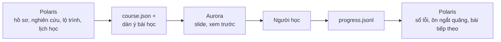

[English](README.md) · **Tiếng Việt**

<p align="center"></p>

# Aurora Slides MCP

*Cực quang tựa như ánh sáng trên sân khấu bài giảng: thắp sáng tri thức bằng những dải sáng uyển chuyển giữa trời đêm.*

MCP server để các AI coding agent (Google Antigravity, Claude Code, Cursor…) soạn **slide tự học đẹp như Apple Keynote**:
chữ lớn, kính mờ, nền cực quang trôi chậm, hiệu ứng lò xo, Magic Move, **exploded view kiểu trang giới thiệu Mac**
(vật thể nguyên vẹn → zoom vào → linh kiện tách lớp khi cuộn chuột), cùng các khối học tương tác: quiz, lật thẻ,
điền khuyết, **trang ghi vào vở**, **bài tập có bấm giờ** và **neo trí nhớ** (cung điện ký ức, neo hình ảnh, phép so sánh, mẹo nhớ).
Mỗi bài là **một file HTML tự chứa**: mở bằng trình duyệt là học được.

Thiết kế theo cách học **lý thuyết → neo trí nhớ → chép vào vở → thực hành → ôn lại**, và theo **khoá học chia nhỏ**:
một chủ đề lớn (ví dụ Máy tính lượng tử) tách thành nhiều bài nhỏ, **mỗi bài một phong cách riêng**, có trang chủ khoá học
theo dõi tiến độ.

Phiên bản hiện tại: **0.8.0**. Tác giả: **DuongNAD**.

## Aurora + Polaris

Aurora Slides kết hợp chặt chẽ với dự án song hành [Polaris](https://github.com/DuongNAD/polaris-mcp), kiến trúc sư khoá học AI của người học.
Polaris xây dựng hồ sơ người học, nghiên cứu sâu tài liệu kèm nguồn, thiết kế lộ trình, lên lịch học và xuất `course.json` cùng dàn ý bài học tại `<chủ-đề>/polaris/lessons/<tên-bài>.outline.md`.
Aurora dựng slide tương tác và ghi nhận tiến độ tự học vào `progress.jsonl`.
Polaris đọc `progress.jsonl` qua `polaris_progress_sync` để tự động điền Sổ lỗi và lên kế hoạch ôn tập ngắt quãng.



- **Ghi tiến độ tự động**: khi học dưới `aurora_preview`, các câu trả lời quiz (kèm văn bản phương án đã chọn, đáp án đúng và giải thích), tự chấm predict, đánh giá cung điện ký ức và đánh giá thẻ ôn tập ngắt quãng tự động ghi nối vào `<thư mục khoá học>/progress.jsonl` (hoặc `<thư mục bài học>/progress.jsonl`).
- **Tóm tắt tiến độ** (`aurora_progress`): tóm tắt độ chính xác quiz (kèm phương án đã chọn và đáp án đúng cho các câu sai), dự đoán đúng/lệch, các trạm cung điện chưa nhớ, số lượt ôn thẻ ngắt quãng (quên, khó, nhớ, dễ), ngày hoàn thành và lịch ôn ngắt quãng (+1, +3, +7, +16, +35 ngày).
- **Nút xuất tiến độ**: nút "Xuất tiến độ" / "Export progress" trong bảng trợ giúp (`?`) và trên trang chủ khoá học cho phép tải file `aurora-progress-<slug>.jsonl`.

Định nghĩa phiên bản chuẩn tắc kèm JSON Schema và dữ liệu mẫu (fixtures) nằm tại [contracts/aurora-progress-event.v1](https://github.com/DuongNAD/constellation-mcp/tree/main/contracts) của Constellation; tài liệu README này tóm tắt lại cấu trúc đó.

### Hệ sinh thái

| Dự án | Vai trò |
|---|---|
| [Polaris](https://github.com/DuongNAD/polaris-mcp) | Kiến trúc sư khoá học |
| Aurora Slides (repo này) | Bài học, luyện tập và tiến độ |
| [Vega](https://github.com/DuongNAD/vega-mcp) | Động cơ ghi nhớ ngắt quãng (FSRS), tạo phiên ôn tập hàng ngày |
| [SmartDrive-OS](https://github.com/DuongNAD/smart-drive-os) | Quản trị SSD, tìm kiếm tối ưu cho học tập, bảo vệ thư mục khoá học, hook cập nhật chỉ mục sau khi ghi |
| [Constellation](https://github.com/DuongNAD/constellation-mcp) | Một manifest duy nhất, đăng ký vào Claude Code / Antigravity / Cursor / Codex, kiểm tra sức khoẻ, drift doctor, cập nhật |
| Orion | Phòng luyện tập chấm bằng test thật, gợi ý theo thang bậc, đoán rồi chạy, theo dõi các lần thử |
| Mira | Trình dò mã: ghi lại quá trình chạy Python thật và dựng trình phát tự chứa mà Aurora nhúng bằng slide `trace`; dự đoán của người học chảy vào nhật ký tiến độ của Aurora |
| Sirius | Vòng lặp thực thi: hạn chót, phân loại ưu tiên, chọn việc hôm nay, đồng hồ phiên học, tổng kết tuần |

## Aurora + SmartDrive-OS

Aurora Slides tự động đồng bộ với dự án song hành [SmartDrive-OS](https://github.com/DuongNAD/smart-drive-os). Sau khi Aurora ghi file học tập (slide bài giảng, trang khoá học, hình ảnh hoặc tiến độ học), Aurora sẽ yêu cầu SmartDrive-OS cập nhật chỉ mục tìm kiếm SQLite FTS5 cho thư mục đó (`smart-drive update <dir> --quiet` chạy ngầm) để lệnh tìm kiếm `smart-drive search --kind slide ...` tìm thấy ngay các bài học mới tạo hoặc vừa chỉnh sửa.

- **Không chặn & gom lệnh (coalesced)**: Lệnh chạy nền độc lập với thời gian chờ 60 giây và tự động gộp các thay đổi trong vòng 2 giây trên cùng một thư mục.
- **Tắt tính năng**: Đặt `AURORA_SMARTDRIVE=off` để tắt thông báo cập nhật chỉ mục SmartDrive-OS.
- **Tuỳ biến lệnh**: Đặt `AURORA_SMARTDRIVE_CMD` (ví dụ `python -m smart_drive` hoặc đường dẫn `smart-drive`) để chỉ định lệnh cập nhật.

## Aurora + Mira

Dự án song hành Mira ghi lại **quá trình chạy Python thật** và dựng một trình phát tự chứa (một file `index.html` chạy offline) chạy từng dòng code bên cạnh phần minh hoạ trực quan, có **cổng dự đoán**: người học gõ điều sẽ xảy ra rồi mới sang bước kế tiếp.
Aurora nhúng trình phát đó vào bài học bằng slide `trace` và chuyển các dự đoán vào cùng đường ống tiến độ với quiz và slide `predict`, nên Polaris (Sổ lỗi) và Vega (thẻ ôn) nhận được mà không cần sửa gì thêm.

```json
{
  "type": "trace",
  "id": "tim-kiem-nhi-phan",
  "eyebrow": "Chạy từng dòng",
  "title": "Tìm kiếm nhị phân qua từng bước",
  "player": "mira/tim-kiem-nhi-phan/index.html",
  "caption": "Ở mỗi điểm dừng, hãy đoán giá trị của mid trước khi bấm tiếp. Nhấn Esc để quay lại điều hướng slide."
}
```

- **Build**: `player` là đường dẫn tới `index.html` của trình phát, tương đối so với thư mục bài hoặc tuyệt đối. Lúc build, Aurora chép file đó vào `assets/mira/<tên-thư-mục>-<6 ký tự hex của sha1(đường dẫn)>.html` trong thư mục bài (chỉ ghi lại khi nội dung đổi) và dựng một iframe tải lười (`assets/mira/….html?embed=1`) trong cửa sổ kiểu macOS. Thiếu file, hoặc trang không có `<meta name="mira-player">`, chỉ gây cảnh báo lúc build và hiện một thẻ thay thế nhẹ nhàng.
- **Giao thức nhúng `mira-embed.v1`**: trình phát gửi các thông điệp `ready`, `event` và `blur` (`{source: "mira", v: 1, …}`) cho bài học. Aurora chỉ nhận từ các iframe trace của chính nó, trả lời `ready` bằng `hello` (theme và màu nhấn), chỉ chuyển tiếp các sự kiện `predict` hợp lệ (chuỗi bị cắt còn 200 / 2000 / 300 ký tự, `slideId` dạng `mira-stop-<k>`) thành `<id slide>:mira-stop-<k>`, bỏ qua `complete` của trình phát (Aurora tự gửi `complete` riêng) và trả bàn phím về cho bài học khi nhận `blur`, thông điệp mà trình phát gửi khi nhấn Esc bên trong nó.
- **Tiến độ**: sự kiện đi vào bộ đệm localStorage, vào `progress.jsonl` dưới `aurora_preview` và vào nút xuất như mọi sự kiện khác; `aurora_progress` liệt kê chúng dưới mục `Dò code (Mira)`.
- **In và PDF**: trình phát được thay bằng một khối tĩnh gồm tiêu đề, chú thích và dòng `Bản tương tác: assets/mira/….html`.

## Điểm nổi bật

- **Agent tự vẽ ảnh, không tốn API key**: ảnh minh hoạ do chính agent tạo (Antigravity có công cụ tạo ảnh riêng) rồi nạp vào
  bài. Slide chỉ cần ghi `"image": {"generate": "<mô tả>"}`; lúc build Aurora **không gọi API nào**, mà trả về danh sách
  "ảnh cần tạo" để agent vẽ và nạp lại. Key OpenAI/Gemini có trong máy cũng bị bỏ qua, trừ khi bạn tự bật (xem bên dưới).
- **Đúng ngôn ngữ của bạn**: hướng dẫn gửi cho agent (system prompt của MCP, hai prompt `lesson`/`course`, `aurora_guide`) viết
  bằng tiếng Anh cho agent hiểu chính xác, nhưng bắt buộc nội dung bài học và câu trả lời của agent dùng ngôn ngữ bạn viết yêu cầu
  (hỏi bằng tiếng Việt thì ra slide tiếng Việt, `lang: "vi"`). Prompt tạo ảnh, id và từ khoá Mermaid vẫn giữ tiếng Anh.
- **40 loại slide**: title, section, agenda, statement, bullets, split, image (có camera zoom), explode, bento, stats, quote,
  code, timeline, steps, cycle, compare, table, chart, formula, definition, hotspots, notebook, exercise, predict, quiz, flashcards,
  srs, cloze, summary, video, html, palace, anchors, analogy, mnemonic, diagram, order, match, sort, trace.
- **Dò code từng dòng với Mira** (`trace`): trình phát do dự án song hành Mira dựng chạy Python thật từng dòng cạnh phần minh hoạ và dừng ở các cổng dự đoán; Aurora nhúng nó trong cửa sổ kiểu macOS và chuyển các dự đoán vào nhật ký tiến độ (xem Aurora + Mira).
- **Cảnh nền theo bài học** (`scene`): nền và chuyển động khớp với chủ đề bài. 12 cảnh động (leaves – lá cây, cells – tế bào, dna,
  quantum – lượng tử, waves – sóng, molecules – phân tử, circuit – mạch điện, network – mạng, code, orbits – quỹ đạo, geometry – hình
  học, ink – mực tàu) vẽ bằng màu của theme, chạy offline và luôn dịu phía sau tiêu đề; `scene: "auto"` (mặc định) tự chọn theo tên
  bài, khoá học có thể gán cảnh riêng cho từng bài, slide `section` có thể đổi cảnh cho cả chương. Icon lớn chuyển động theo nghĩa
  (lá đung đưa, tia nắng xoay, electron quay quanh nguyên tử) và ảnh nền trôi chậm kiểu điện ảnh (Ken Burns). Lệnh `aurora scenes`
  dựng bộ sưu tập để xem các cảnh.
- **Luyện tập bằng tay** (`order`, `match`, `sort`, `cloze` gõ đáp án): kéo các bước vào đúng thứ tự, nối thuật ngữ với nghĩa bằng
  đường cong, xếp các mục vào nhóm, hoặc gõ từ còn thiếu (không phân biệt dấu, có nhắc khi chỉ sai dấu). Tất cả đều dùng được bằng
  chuột, bàn phím và cảm ứng; sau mỗi lần kiểm tra có "Làm lại" và "Xem đáp án"; lần làm đầu tiên được ghi bằng sự kiện `quiz` sẵn có
  nên Polaris ghi lỗi sai mà không phải đổi hợp đồng. Quiz cũng có thêm "Làm lại".
- **Giao diện Liquid Glass**: thẻ kính có viền sáng phía trên và ánh sáng mềm chạy theo chuột, nền trôi nhẹ qua từng slide và đổi sắc
  theo chương, slide mở chương có số gradient và thanh chương, thanh tiến độ chia theo chương: rê chuột thấy tên slide, bấm để nhảy tới.
- **Phiên ôn tập ngắt quãng** (`srs`): dự án song hành [Vega](https://github.com/DuongNAD/vega-mcp) (động cơ FSRS) tạo deck ôn tập hàng ngày gồm các slide `srs` (mặt trước → gợi ý → lật mặt sau → hàng phím 1–4 "Quên / Khó / Nhớ / Dễ"), phát sự kiện `card` để dời lịch thẻ.
- **Luyện tập đoán rồi chạy** (`predict`): người học ghi dự đoán vào ô nhập (tự lưu theo bài), chạy code thật trong cửa sổ Terminal
  macOS hoạt hoạ, đối chiếu kết quả thật, tự chấm Đúng như dự đoán / Lệch (phím 1/2) và ghi chỗ lệch vào Sổ lỗi.
- **Trích dẫn code nguyên văn** (`code`, `split`, `exercise`, `predict`): trích code thật từ file bằng `file` + `lines` (kèm `dedent`),
  hiện đúng số dòng nguồn thực tế và highlight mà không cần gõ lại từ trí nhớ.
- **Ghi nguồn từng slide** (`source`): mỗi slide có thể kèm chú thích nguồn ngắn gọn ở góc dưới bên trái có tooltip và link markdown.
- **Neo trí nhớ**: `palace` là cung điện ký ức. Camera đi dọc lộ trình trong một nơi quen thuộc (căn nhà của bạn, đường tới
  trường), mỗi trạm cất một ý kèm một cảnh để hình dung, có đường nối từ điểm neo tới thẻ; cuộn chuột để "đi". Có thể dùng
  sơ đồ tự vẽ hoặc ảnh căn nhà. Cuối bài có vòng ôn: các ý bị che, đến mỗi trạm tự nhớ rồi chấm Nhớ / Chưa nhớ.
  Ngoài ra: `anchors` (mỗi khái niệm một hình ảnh), `analogy` (neo vào điều đã biết, kèm chỗ không giống),
  `mnemonic` (câu thần chú kiểu "Sin đi học, Cos không hư…"), dòng `@ ` trên trang vở để ghi móc nhớ.
- **Sơ đồ bằng Mermaid** (`diagram`): agent viết code [Mermaid](https://mermaid.js.org) cho lưu đồ, bản đồ tư duy, sơ đồ tuần tự,
  trạng thái, lớp, ER, dòng thời gian, gantt, sankey, biểu đồ cột/tròn… Aurora vẽ sẵn thành SVG lúc build bằng Chrome/Edge,
  tô màu theo theme của bài, nên bài học vẫn nhẹ và mở offline được. Khi trình chiếu, các hộp hiện dần, mũi tên tự vẽ nối
  giữa chúng; `steps` cho hiện từng hộp mỗi lần nhấn →; `look: "handDrawn"` cho nét vẽ tay. Viết sai cú pháp thì slide báo
  lỗi kèm dòng sai để agent sửa.
- **9 theme**: aurora, midnight, daylight, titanium, ocean, sunset, forest, paper, liquid (Liquid Glass).
- **Khoá học**: `course.json` + trang chủ khoá học (thẻ bài mang màu theme của từng bài, nhãn lịch học `when` tuỳ chọn, vòng tiến độ, nút "Học tiếp");
  trong mỗi bài có đường dẫn về khoá học và nút "Bài tiếp theo". Trang khoá học nhắc **lịch ôn ngắt quãng**: bài đã học
  hiện "Đến hạn ôn" sau 1, 3, 7, 16, 35 ngày.
- **Độ chính xác & lint sư phạm chặt chẽ**: lint kiểm tra cung điện ký ức, vòng ôn, tỷ lệ slide điều hướng, số lượng slide thực hành, code kèm predict, và trích dẫn nguồn. Mục hướng dẫn `accuracy` rèn agent bám sát tài liệu gốc, trích dẫn code nguyên văn, không nói quá và tạo câu nhiễu quiz thực tế.
- Công thức toán (KaTeX) và hoá học `\ce{...}`; code highlight kiểu Xcode; xem trước có live reload; xuất PDF;
  font **Be Vietnam Pro** nhúng sẵn, không lỗi dấu tiếng Việt.

## Ảnh: agent tự tạo là ưu tiên số 1

Thứ tự Aurora khuyên agent dùng (ghi trong hướng dẫn và mô tả tool, nên agent tự làm theo):

1. **Agent tự tạo ảnh** bằng công cụ của nó (Antigravity: tạo ảnh ngay trong cuộc trò chuyện). Có hai cách nối vào bài:
   - Tạo ảnh trước, rồi `aurora_add_image {"dir": …, "path": "<file ảnh>"}` để chép vào thư mục `images/` của bài.
   - Hoặc ghi `"image": {"generate": "<prompt>"}` ngay trong slide. Build xong, kết quả có mục
     **"Pictures for you to make"**: mỗi ảnh có mã (id), số slide, khung hình (ngang 16:9, dọc 3:4, vuông 1:1) và prompt.
     Agent tạo từng ảnh rồi gọi `aurora_add_image {"dir": …, "path": "<file ảnh>", "for": "<id>"}`: ảnh được lưu thành
     `images/gen-<id>.png` và bài tự build lại. Khi ảnh chưa có, slide hiện một ô kính mờ ghi prompt thay cho ảnh.
     Cách này giữ prompt trong `deck.json`, nên lần sau làm lại bài vẫn ra cùng một phong cách.
2. **Ảnh thật trên mạng**: `{"query": "chloroplast microscope"}` hoặc `aurora_search_images` (Openverse, Wikimedia miễn phí;
   Unsplash/Pexels nếu có key).
3. **Agent tự vẽ SVG** (`{"svg": "<svg …>"}`) cho hình đơn giản: trục toạ độ, mạch điện, tế bào, quả cầu Bloch.
4. **Dự phòng** cho agent không tạo được ảnh: `aurora_generate_image` dùng Pollinations (miễn phí, không cần key, chất lượng
   thấp hơn).

Muốn Aurora tự gọi OpenAI/Gemini lúc build (tốn tiền), đặt biến `AURORA_IMAGE_PROVIDER`:

| Giá trị | Ý nghĩa |
|---|---|
| `agent` (mặc định) | Không gọi API ảnh nào khi build; prompt thành danh sách ảnh để agent tạo. Key trong máy bị bỏ qua |
| `pollinations` | Tạo lúc build bằng Pollinations (miễn phí, có watermark nhỏ) |
| `openai` / `gemini` | Tạo lúc build bằng OpenAI gpt-image / Gemini (cần `OPENAI_API_KEY` / `GEMINI_API_KEY`, tốn tiền) |
| `auto` | Cách cũ: OpenAI, rồi Gemini (nếu có key), rồi Pollinations |

Ảnh đã có trong `images/gen-<id>.*` của bài luôn được dùng lại ở mọi chế độ, nên không bao giờ phải trả tiền hai lần.

## Cài đặt

Yêu cầu: Node.js 22.4+ và Google Chrome hoặc Microsoft Edge (để vẽ sơ đồ, chụp ảnh, audit, xuất PDF).

`dist/aurora.mjs` đã được build sẵn trong repo: clone về là chạy được, không cần cài gì thêm.

```bash
git clone https://github.com/DuongNAD/aurora-slides-mcp.git
```

Khi sửa mã nguồn (`src/`, `runtime/`, `guide/`) thì build lại:

```bash
node scripts/build.mjs --install --check
```

Lệnh trên cài toolchain (TypeScript, esbuild, MCP SDK, KaTeX, Shiki…) vào `%LOCALAPPDATA%\aurora-slides\toolchain`
(Linux/macOS: `~/.cache/aurora-slides/toolchain`) rồi build ra `dist/aurora.mjs`. Lần đầu nó cũng tải gói Mermaid từ npm nhưng
chỉ lấy đúng một file `assets/mermaid.min.js` (khoảng 5 MB, chỉ dùng lúc build, không nhúng vào bài).
Những lần sau chỉ cần `node scripts/build.mjs --check`.

> **Đừng chạy `npm install` trong thư mục dự án.** Dự án cố ý không có `node_modules`: mọi dependency nằm ở toolchain bên ngoài,
> repo chỉ giữ một file bundle. Nhờ vậy có thể đặt dự án trên ổ exFAT hay USB (cluster lớn) mà không sinh hàng nghìn file nhỏ.

## Kết nối với agent

Khi đã cài đặt Constellation, `constellation register --dry-run` rồi `constellation register` sẽ giữ cấu hình của mọi agent luôn đồng bộ.

Đăng ký Aurora với tên `aurora-slides`, rồi tải lại danh sách MCP (hoặc mở lại Antigravity / Claude Code) để agent nhìn thấy
các tool. Thay `C:/path/to/aurora-slides-mcp` bằng thư mục bạn đã clone.

**Google Antigravity**: thêm vào `mcpServers` trong `%USERPROFILE%\.gemini\antigravity\mcp_config.json`
(Cursor dùng cùng định dạng trong `.cursor/mcp.json`):

```json
{
  "mcpServers": {
    "aurora-slides": {
      "command": "node",
      "args": ["C:/path/to/aurora-slides-mcp/dist/aurora.mjs"]
    }
  }
}
```

**Claude Code**:

```bash
claude mcp add aurora-slides --scope user -- node "C:/path/to/aurora-slides-mcp/dist/aurora.mjs"
```

Biến môi trường tuỳ chọn (đặt trong khối `"env"` của cấu hình MCP):

| Biến | Tác dụng |
|---|---|
| `AURORA_IMAGE_PROVIDER` | Cách xử lý `generate`: `agent` (mặc định), `pollinations`, `openai`, `gemini`, `auto` (xem mục Ảnh) |
| `OPENAI_API_KEY` / `GEMINI_API_KEY` | Chỉ được dùng khi `AURORA_IMAGE_PROVIDER` là `openai`, `gemini` hoặc `auto` |
| `AURORA_OPENAI_IMAGE_MODEL`, `AURORA_GEMINI_IMAGE_MODEL` | Đổi model tạo ảnh |
| `UNSPLASH_ACCESS_KEY`, `PEXELS_API_KEY` | Ảnh Unsplash/Pexels đẹp hơn thay vì Openverse/Wikimedia |
| `AURORA_DECKS_DIR` | Thư mục mặc định chứa bài (mặc định `./slides` của dự án agent đang mở) |
| `AURORA_BROWSER` | Đường dẫn Chrome/Edge nếu không tự tìm thấy |
| `AURORA_PORT` | Cổng server xem trước (mặc định 4747) |
| `AURORA_HOME` | Thư mục cache icon/ảnh/sơ đồ (mặc định `%LOCALAPPDATA%\aurora-slides`) |
| `AURORA_SMARTDRIVE` | Đặt thành `off` để tắt thông báo cập nhật chỉ mục SmartDrive-OS |
| `AURORA_SMARTDRIVE_CMD` | Lệnh tuỳ biến cho SmartDrive-OS (ví dụ `python -m smart_drive`) |

## Dùng thế nào

Chỉ cần nói với agent. Ví dụ một bài học trong ngày, giao cho Antigravity:

> Dùng aurora-slides làm bài học hôm nay về **Định luật Ôm** cho mình: lý thuyết → neo trí nhớ → trang ghi vở → bài tập từ dễ
> đến khó → ôn lại. Ảnh minh hoạ thì **tự tạo bằng công cụ tạo ảnh của bạn**, cùng một phong cách cho cả bài, không có chữ
> trong ảnh, rồi nạp vào bằng `aurora_add_image`. Xong thì chụp ảnh kiểm tra, sửa lỗi audit và mở bản xem trước.

Hoặc cả một khoá học:

> Dùng aurora-slides làm khoá học **Máy tính lượng tử** gồm 5 bài nhỏ: lý thuyết lượng tử, cổng lượng tử, rối lượng tử,
> mạch và thuật toán, phần cứng. Mỗi bài một theme khác nhau, có trang ghi vở sau phần lý thuyết và bài tập từ dễ đến khó.
> Bài phần cứng làm exploded view bên trong máy tính lượng tử. Mỗi bài có một cung điện ký ức trong căn nhà của mình
> để nhớ các ý chính, cuối bài đi lại một vòng để ôn. Ảnh tự tạo rồi nạp vào. Xong thì chụp ảnh kiểm tra và mở bản xem trước.

Viết yêu cầu bằng ngôn ngữ nào thì slide và câu trả lời của agent dùng ngôn ngữ đó.

Trong Claude Code còn có prompt dựng sẵn: `/mcp__aurora-slides__course` và `/mcp__aurora-slides__lesson`.

Bài học được lưu vào `./slides/<tên-bài>/` của dự án agent đang mở (gồm `deck.json`, `index.html` và `images/`).
Mở `index.html` bằng trình duyệt là học được.

Các tool agent dùng:

| Tool | Việc |
|---|---|
| `aurora_guide` | Hướng dẫn viết slide, từng loại slide kèm ví dụ JSON, cách chia khoá học, cách lấy ảnh |
| `aurora_create_course` | Tạo/sửa khoá học: danh sách bài, theme từng bài, trang chủ khoá học |
| `aurora_create_deck` | Tạo/ghi đè một bài (deck.json + index.html), báo lỗi chính xác nếu JSON sai, liệt kê ảnh cần tạo |
| `aurora_edit_deck` | Sửa từng slide: replace, insert, delete, move, update, deck |
| `aurora_get_deck`, `aurora_build` | Đọc lại deck; build lại deck hoặc cả khoá học |
| `aurora_add_image` | Nạp ảnh agent tự tạo/tìm (file, URL, base64) vào bài; `for` điền đúng ảnh slide đang chờ rồi tự build lại |
| `aurora_search_icons`, `aurora_search_images` | Tìm icon (Iconify, hơn 200 nghìn mẫu) và ảnh trên mạng |
| `aurora_generate_image` | Dự phòng cho agent không tự tạo được ảnh (Pollinations miễn phí) |
| `aurora_screenshot`, `aurora_audit` | Agent tự nhìn slide (cả từng nấc hiệu ứng) và kiểm tra lỗi bố cục |
| `aurora_preview` | Server xem trước 127.0.0.1 có live reload (deck hoặc cả khoá học) |
| `aurora_progress` | Tóm tắt tiến độ học tập (độ chính xác quiz, dự đoán đúng/lệch, cung điện ký ức, lịch ôn) |
| `aurora_export_pdf` | Xuất PDF 16:9 |

## Khi học

| Thao tác | Việc |
|---|---|
| → / Space / cuộn xuống | Tiếp theo (từng ý, từng dòng vở, từng bước lời giải, từng nấc exploded view, lật thẻ SRS) |
| ← / cuộn lên | Quay lại |
| N | Ghi chú chi tiết của slide |
| O / Esc | Tổng quan toàn bài |
| F | Toàn màn hình |
| T | Bật/tạm dừng đồng hồ bài tập |
| 1–6 | Chọn đáp án quiz |
| 1–4 | Đánh giá thẻ ôn tập ngắt quãng (Quên / Khó / Nhớ / Dễ) trên slide `srs` |
| 1 / 2 | Nhớ / Chưa nhớ khi ôn cung điện; Đúng như dự đoán / Lệch khi học slide predict |
| H | Hiện/ẩn gợi ý trên slide `srs` |
| Esc (trong trình phát Mira) | Trả bàn phím về cho bài học để → / ← lại chuyển được slide |

Trên slide exploded view và cung điện ký ức, cuộn chuột/trackpad sẽ "tua" hiệu ứng liên tục như trang Apple. Bài học nhớ
chỗ đang học, trang khoá học hiện tiến độ từng bài và những bài đến hạn ôn.

## Xử lý sự cố

### Antigravity: "tool … is not enabled for server aurora-slides"
Trong Google Antigravity, danh sách tool được nhận diện và gắn vào phiên khi cuộc trò chuyện bắt đầu. Khi mở Antigravity, MCP server có thể mất 1–2 phút để khởi động xong dưới nền. Nếu bạn nhắn tin trước khi server sẵn sàng, cuộc trò chuyện đó sẽ không gọi được tool.
**Cách xử lý**: Chờ một lát cho MCP server khởi động xong rồi mở một **cuộc trò chuyện mới**.

## CLI

```bash
node dist/aurora.mjs build examples/quang-hop             # build một bài (in ra cả danh sách ảnh cần tạo nếu có)
node dist/aurora.mjs build examples/may-tinh-luong-tu     # build cả khoá học
node dist/aurora.mjs serve examples/may-tinh-luong-tu --open
node dist/aurora.mjs shot examples/quang-hop --sheet      # contact sheet
node dist/aurora.mjs shot examples/quang-hop --slides 8 --step 2
node dist/aurora.mjs audit examples/quang-hop
node dist/aurora.mjs pdf examples/quang-hop
node dist/aurora.mjs images "chloroplast microscope"      # tìm ảnh
node dist/aurora.mjs icons leaf atom --style duotone      # tìm icon
node dist/aurora.mjs generate "glowing qubit chip, dark navy, soft light, no text"   # Pollinations miễn phí
node dist/aurora.mjs showcase --theme forest              # deck mẫu dùng mọi layout
node dist/aurora.mjs selftest                             # chạy thử runtime trong Chrome headless
node scripts/e2e.mjs                                      # kiểm thử MCP end-to-end (mọi tool, kể cả luồng ảnh của agent)
```

## Ví dụ có sẵn

- `examples/quang-hop`: bài "Quang hợp" (lý thuyết → neo trí nhớ → ghi vở → thực hành → ôn lại): cung điện "Pha sáng:
  một vòng quanh nhà", phép so sánh lục lạp với nhà máy điện mặt trời, mẹo nhớ "Con kiến tha mồi", bản đồ tư duy toàn cảnh
  vẽ bằng Mermaid.
- `examples/may-tinh-luong-tu`: khoá học "Máy tính lượng tử" 5 bài (3 bài đã viết, 2 bài "Sắp có"), mỗi bài một theme;
  bài 1 có cung điện ký ức vẽ trên sơ đồ một căn hộ (7 ý về qubit, 7 góc trong nhà), bài 2 mở đầu bằng vòng ôn bài 1 và có
  lưu đồ Mermaid đi từng bước qua mạch tạo trạng thái Bell, bài 5 có exploded view tủ lạnh pha loãng.

## Cấu trúc

```
src/        TypeScript: schema, render, course, imagegen, MCP tools, CLI
runtime/    aurora.css + aurora.js chạy trong trình duyệt
guide/      GUIDE.md cho agent
examples/   bài và khoá học mẫu
assets/     runtime đã minify, font và KaTeX nhúng base64, mermaid.min.js (sinh bởi build)
dist/       aurora.mjs: một file duy nhất chứa toàn bộ server (build sẵn, có trong repo)
scripts/    build.mjs (toolchain nằm ngoài dự án), e2e.mjs (kiểm thử MCP)
PLAN.md     trạng thái, ý tưởng tiếp theo, ràng buộc
```

## Lịch sử phiên bản

- **0.8.0** (12/10/2026):
  - Giao diện Liquid Glass: viền kính sáng và ánh sáng theo chuột trên thẻ, đáp án quiz, thẻ lật và thanh điều khiển; nền trôi theo slide, đổi sắc theo chương; slide section có số gradient và thanh chương; thanh tiến độ chia chương, rê chuột hiện tên slide, bấm để nhảy tới.
  - Các slide luyện tập `order`, `match`, `sort` và `cloze` với `input: true` (đáp án thay thế `[[hiển thị|thay thế]]`): kéo-thả có chuyển động FLIP, kèm cách làm bằng chuột, bàn phím và cảm ứng; trộn cố định lúc build; lần làm đầu gửi bằng sự kiện `quiz`; "Làm lại" / "Xem đáp án"; quiz có thêm "Làm lại".
  - Cảnh nền theo bài học: 12 cảnh động khớp chủ đề (`scene` cho bài, cho bài trong khoá học hoặc cho một chương; `auto` chọn theo tên bài bằng từ khoá tiếng Việt có phân biệt dấu và tiếng Anh), icon chuyển động theo nghĩa (`motion`), Ken Burns cho ảnh nền, xem trước cảnh trên thẻ bài của trang khoá học, lệnh `aurora scenes`.
  - Slide `trace` mới nhúng trình phát do dự án song hành Mira dựng (`mira_build`): lúc build chép trình phát vào `assets/mira/` và dựng iframe tải lười trong cửa sổ kiểu macOS; thiếu trình phát hoặc trang không có thẻ meta `mira-player` chỉ gây cảnh báo và hiện thẻ thay thế.
  - Giao thức nhúng `mira-embed.v1`: runtime chỉ nhận thông điệp `ready`, `event`, `blur` từ iframe trace của chính nó, trả lời `ready` bằng `hello` (theme, màu nhấn), chuyển các sự kiện `predict` hợp lệ vào đường ống tiến độ dưới dạng `<id slide>:mira-stop-<k>` (bộ đệm localStorage, `/__aurora/progress`, nút xuất), bỏ qua `complete` của trình phát và trả bàn phím về cho bài học khi nhận `blur`.
  - `aurora_progress` liệt kê dự đoán của Mira dưới mục `Dò code (Mira)`; gợi ý sư phạm khi slide trace không có chú thích và không có slide `code` hay `predict` đứng trước; audit cảnh báo khi thiếu trình phát; khi in hoặc xuất PDF, trình phát được thay bằng một khối tĩnh.
  - Hướng dẫn: loại `trace` (các trường, ví dụ tiếng Việt, khi nào dùng), phím Esc, và Mira, Orion, Sirius trong danh sách hệ sinh thái.
  - e2e: schema, chép tài nguyên, phương án dự phòng, kiểm tra thông điệp và kiểm tra chuyển tiếp sự kiện trong trình duyệt thật.
- **0.7.1** (11/10/2026):
  - Chấp nhận `eyebrow` trên slide `statement` như một bí danh của `kicker` (giúp đồng nhất cú pháp với toàn bộ các loại slide khác).
  - Khi cung cấp cả `kicker` và `eyebrow`, `kicker` sẽ được ưu tiên và hệ thống xuất ghi chú nội dung (content note).
  - Renderer xử lý `kicker` và `eyebrow` đồng nhất; guide và catalog tài liệu hóa `kicker` kèm "(alias: eyebrow)".
  - Duy trì kiểm tra tính hợp lệ và cơ chế sửa lỗi gợi ý cho các trường lạ và lỗi chính tả.
- **0.7.0** (11/10/2026):
  - Phiên ôn tập ngắt quãng (loại slide `srs`) tạo bởi dự án song hành [Vega](https://github.com/DuongNAD/vega-mcp) (động cơ FSRS).
  - Bố cục thẻ kính mờ kiểu Apple: mặt trước (câu hỏi/khái niệm), nút mở gợi ý (`H`), lật mặt sau (→ / Space / click) kèm móc nhớ, link nguồn gốc bài học, và hàng phím đánh giá 1–4 ("Quên / Khó / Nhớ / Dễ").
  - Sự kiện tiến độ `card` mới phát ra khi đánh giá thẻ, ghi nhận `card` id, `rating`, và thời gian ôn `ms`.
  - Thẻ điểm trên slide tổng kết hiển thị số lượng thẻ đã ôn (`Đã ôn x/y thẻ · Quên a`).
  - Preview server tiếp nhận sự kiện `card` theo đúng contract và `aurora_progress` tóm tắt số lượng đánh giá theo từng bài.
  - Lint sư phạm tự động bỏ qua các lưu ý không áp dụng cho deck ôn tập khi có ≥ 80% slide `srs`.
- **0.6.2** (11/10/2026):
  - Tích hợp SmartDrive-OS: tự động kích hoạt cập nhật chỉ mục (`smart-drive update <dir> --quiet`) sau khi ghi bài học, khoá học, ảnh và tiến độ để `smart-drive search --kind slide ...` tìm thấy ngay bài học mới và chỉnh sửa. Chạy ngầm không chặn luồng build, tự gom lệnh trong 2 giây. Tuỳ biến qua `AURORA_SMARTDRIVE=off` và `AURORA_SMARTDRIVE_CMD`.
- **0.6.1** (11/10/2026):
  - Sự kiện tiến độ quiz tự diễn giải: bổ sung các trường tuỳ chọn `chosenText` và `answerText` (mảng văn bản thuần của các phương án, tối đa 160 ký tự mỗi mục) cùng `explanation` (tối đa 300 ký tự) vào sự kiện `quiz` giúp Sổ lỗi Polaris và `aurora_progress` hiển thị trực tiếp phương án đã chọn và đáp án đúng cho các câu sai.
- **0.6.0** (10/10/2026):
  - Khép kín vòng lặp học tập với dự án song hành [Polaris](https://github.com/DuongNAD/polaris-mcp): runtime phát sự kiện học tập (`quiz`, `predict`, `recall`, `complete`) vào bộ đệm localStorage và preview server ghi file `progress.jsonl` trong thư mục khoá học.
  - MCP tool mới `aurora_progress`: tóm tắt tiến độ từng bài với độ chính xác quiz, dự đoán đúng/lệch, các trạm cung điện chưa nhớ, ngày hoàn thành và lịch ôn ngắt quãng (+1, 3, 7, 16, 35 ngày).
  - Nút "Xuất tiến độ" / "Export progress" trong bảng trợ giúp và trang chủ khoá học để tải `aurora-progress-<slug>.jsonl`.
  - Nhận diện dàn ý bài học Polaris trong `buildDeck`: in đường dẫn dàn ý và nhắc trích nguồn trong `source`.
- **0.5.0** (10/10/2026):
  - Luyện tập đoán rồi chạy (`predict`): người học ghi dự đoán vào ô nhập (tự lưu theo bài), chạy code thật trong Terminal macOS, tự chấm bằng phím 1/2 ("Đúng như dự đoán" / "Lệch") và chép chỗ lệch vào Sổ lỗi.
  - Trích dẫn code nguyên văn: trích file thật với `file` + `lines` (kèm `dedent`), giữ đúng số dòng nguồn thực tế và thẻ báo lỗi nếu thiếu file.
  - Chú thích nguồn từng slide (`source`): hiển thị ở góc dưới bên trái.
  - Nhãn lịch học `when` trên thẻ bài khoá học.
  - Lint sư phạm nâng cao & chủ đề hướng dẫn `accuracy` (bám sát tài liệu gốc, không gõ lại code từ trí nhớ, câu nhiễu quiz thực tế, không nói quá).
  - Căn giữa ô giữ chỗ ảnh và bản địa hoá thẻ lỗi code theo `STRINGS`.
- **0.4.0** (10/10/2026): agent tự tạo ảnh là mặc định. `generate` thành danh sách ảnh cần tạo, `aurora_add_image {for}`
  điền ảnh và tự build lại, key OpenAI/Gemini chỉ dùng khi bật `AURORA_IMAGE_PROVIDER`. System prompt cho agent viết lại
  bằng tiếng Anh (Workflow / Rules / Done when), nội dung và câu trả lời theo ngôn ngữ của người dùng.
- **0.3.0**: slide `diagram` vẽ từ Mermaid lúc build, tô theo theme, hiện từng bước.
- **0.2.0**: neo trí nhớ: `palace`, `anchors`, `analogy`, `mnemonic`, dòng `@ ` trong vở, lịch ôn ngắt quãng.
- **0.1.0**: 29 loại slide, khoá học, 14 tool MCP, ảnh, CLI, selftest và e2e.

## Tác giả, giấy phép và thư viện

Aurora Slides do **DuongNAD** ([github.com/DuongNAD](https://github.com/DuongNAD)) xây dựng. Mã nguồn trong `src/`, `runtime/`, `guide/` và `scripts/`
được viết riêng cho dự án này và phát hành theo **giấy phép MIT** (xem [LICENSE](LICENSE)): ai cũng được dùng, sửa, phân phối,
kể cả cho mục đích thương mại, miễn là giữ lại thông báo bản quyền và giấy phép.

Aurora dùng các thư viện mã nguồn mở, mỗi thư viện giữ giấy phép của tác giả: Model Context Protocol SDK, zod, KaTeX, Shiki,
Mermaid, esbuild, TypeScript (MIT / Apache-2.0), font Be Vietnam Pro, Inter, JetBrains Mono (SIL Open Font License).
Icon lấy từ Iconify và ảnh lấy từ Openverse, Wikimedia, Unsplash, Pexels có giấy phép riêng của từng tác giả; Aurora tự ghi
nguồn ảnh dưới mỗi tấm.
